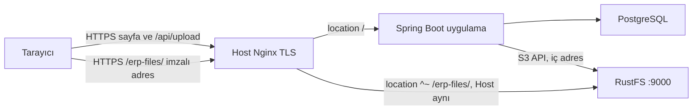

# Özerler Mermer ERP Platform

> **Enterprise-grade, end-to-end physical traceability, 10-code scrap management, and dynamic Activity-Based Costing (ABC) platform for the natural stone industry.**

[](https://openjdk.org/projects/jdk/24/)
[](https://spring.io/projects/spring-boot)
[](http://localhost:81)
[-blueviolet.svg)](https://pmd.github.io/)
[](https://www.jacoco.org/)
[](https://www.postgresql.org/)
[-orange.svg)](https://rustfs.com/)

---

## 🎯 Value Proposition

**Özerler Mermer ERP** replaces generic inventory tools with domain-driven stone lifecycle management. From raw quarry block extraction ($m^3$, tonnage deviation analysis) through gangsaw cutting, resin/polishing lines, custom workshop sizing, and architectural site Work Breakdown Structures (WBS), every physical transformation is tracked with full bidirectional genealogy, dynamic grade-weighted pricing, and root-cause scrap telemetry.

---

## 🚀 Key Features

- **Quarry Block Intelligence**: 3-axis dimensional measurement ($m^3$), theoretical vs. weighbridge scale variance tracking ($>5\%$ deviation alerts), and gangsaw dispatch workflows.
- **Gangsaw & Grade Multiplier Costing**: Weighted allocation algorithm ($K_{Extra}=1.30$, $K_A=1.15$, $K_B=1.00$, $K_C=0.65$) distributing block cost based on realized surface quality.
- **10-Reason Scrap Management**: Granular root-cause tracking from `FR-01` (Saw Dust) through `FR-10` (Site Installation Breakage) with real-time financial impact calculation.
- **Genealogy & Digital Stone Passport**: Bidirectional lineage trees mapping final installation tiles back to source slabs, production orders, and extraction quarries via public QR-code URLs.
- **Smart Pricing & Margin Guardrails**: Real-time margin simulation calculating standard cost, suggested selling price, and minimum floor price warnings.
- **Enterprise System Settings & Security**: Database-backed dynamic controls for Two-Factor Authentication (2FA), Google reCAPTCHA v2/v3, dynamic SMTP dispatch, and customizable HTML email templates.
- **Operational Report Center**: Multi-tab live reporting engine exporting 6 domain datasets to auto-formatted Excel (`.xlsx`) and UTF-8 BOM CSV (`.csv`).
- **Structured JSON Observability**: Production-grade Logstash JSON logging over Logback with MDC diagnostic correlation (`traceId`, `userId`) and a dedicated `/admin/dashboard/systemhealth/` metric cockpit.
- **Object File Storage**: Block photos, SVG, PDF, Excel, Word, CSV, TXT, and Markdown attachments stored in private RustFS buckets (S3 API), with metadata in PostgreSQL. MinIO is not used.

---

## 🛠️ Tech Stack

| Category | Technologies & Tools |
| :--- | :--- |
| **Backend Framework** | Java 24 (Eclipse Temurin 24.0.2), Spring Boot 4.2.0, Spring Security 7.x, Spring Data JPA |
| **Persistence & Migration** | PostgreSQL 16, Hibernate 7.x, Flyway 12.11.0, HikariCP |
| **Object Storage** | RustFS Docker (S3-compatible API), AWS SDK for Java v2 |
| **Frontend & UI/UX** | Thymeleaf 3, Tailwind CSS 4, HTMX 2, Alpine.js 3, Tabulator 6, Lucide Icons |
| **Rich Editing & Uploads**| TipTap Editor, CodeMirror 6, FilePond 4 with client-side image optimization |
| **Reporting & Utilities** | Apache POI 5.3.0, Apache Commons (`commons-lang3`, `commons-collections4 4.5.0`) |
| **Logging & Telemetry** | SLF4J, Logback, `logstash-logback-encoder 8.0`, Spring Boot Actuator |
| **Quality & Testing** | JUnit 5, Mockito, AssertJ, `maven-pmd-plugin 3.28.0` (PMD 7.17.0), `jacoco-maven-plugin 0.8.16` |
| **Container & CI/CD** | Docker (Multi-stage Temurin 24), Docker Compose v2; production deploys are manual via `scripts/deploy_production.sh` |

---

## 🏛️ Architecture & Design

The platform adheres to **Layered Clean Architecture** and **Domain-Driven Design (DDD)** principles:

- **Presentation Layer (`com.ozerler.marble.controller`)**: Dedicated controllers for Administrative operations, ERP domain modules, Public Digital Passports, and JSON REST endpoints.
- **Data Transfer & Dual Mapping (`com.ozerler.marble.dto`)**: DTOs annotated with `@JsonProperty("snake_case")` paired with `@JsonAlias("camelCase")` and `@NotBlank(message = "Missing required field: {field_name}")` for complete client interoperability.
- **Domain Service Layer (`com.ozerler.marble.service`)**: Encapsulates business logic, activity-based cost calculations, gangsaw transformations, and report synthesis.
- **Object Storage (`com.ozerler.marble.storage`)**: `ObjectStorageService` abstraction over the S3 API; RustFS stores binaries, PostgreSQL stores `file_storage` metadata.
- **Persistence Layer (`com.ozerler.marble.repository`)**: Strongly typed Spring Data JPA repositories with parameterized native/HQL queries.
- **Cross-Cutting Concerns (`com.ozerler.marble.config`, `common`)**: Centralized [Constants.java](src/main/java/com/ozerler/marble/common/Constants.java), Spring Security RBAC filter chains, structured logging converters, and global exception handlers.

### Çalışma zamanı

Üretimde dört parça vardır. Uygulama Spring Boot **4.2.0**’dır. Docker Compose içinde `PORT` ve `SERVER_PORT` **81**’dir ve kapı `${APP_PORT:-81}:81` olarak yayınlanır. PostgreSQL 16 uygulama verisini tutar. RustFS (`marble-rustfs`, servis adı `rustfs`) özel kova `erp-files` içinde dosyaları tutar ve API’yi kapı **9000**’de dinler. HTTPS’i sunucudaki Nginx sonlandırır; bu depo Nginx çalıştırmaz.

Yerel stack `docker/docker-compose.yml` ile açılır. Üretim stack’i `docker-compose.prod.yml` ve `scripts/deploy_production.sh` ile açılır. systemd ile JAR kurulumu [DEPLOYMENT_LINUX.md](DEPLOYMENT_LINUX.md) içindedir; o örnek `SERVER_PORT=8080` kullanır ve `location /` adresini `127.0.0.1:8080`’e yollar. Nginx’teki `location /` hedefi, uygulamanın gerçekten dinlediği kapı olmalıdır.



Sayfa ve yükleme uygulamadan geçer. İndirme, imza üretildikten sonra tarayıcıdan Nginx üzerinden doğrudan RustFS’e gider. Ayrı bir dosya alan adı yoktur; imzalı adres de `https://ozerler.naklink.com` üzerindedir. Böylece HTTPS sayfa ile dosya adresi aynı host’ta kalır.

### Dosya yükleme ve indirme

Kova özeldir. Tarayıcı anahtarsız nesneyi okuyamaz.

1. Oturum açmış kullanıcı `POST /api/upload` ile dosyayı uygulamaya gönderir. Çoklu parça üst sınırı `50MB`’tır.
2. Uygulama nesneyi S3 istemcisiyle **iç** adrese yazar. Üretimde bu adres `RUSTFS_ENDPOINT` (varsayılan `http://rustfs:9000`) olur. İstemci path-style ve bölge `us-east-1` kullanır.
3. PostgreSQL `file_storage` satırında üst veri durur. İmzalı adres veritabanına yazılmaz.
4. Sayfa çizilirken resimler için yeni bir imza üretilir (`presignedImageUrl`). Belge indirme `GET /api/upload/{id}/download-url` ile istenir. JSON gövdesi `url`, `expiresInSeconds` ve `expiresAt` alanlarını döner. Adres günlüğe yazılmaz.
5. Resim süresi `PRESIGNED_IMAGE_EXPIRY_MINUTES` (varsayılan **30** dakika), diğer dosyalar `PRESIGNED_DOCUMENT_EXPIRY_MINUTES` (varsayılan **5** dakika) olur.
6. İmza, `RUSTFS_PUBLIC_ENDPOINT` host’una yazılır. Üretim varsayılanı `https://ozerler.naklink.com`’dur. Adres biçimi `https://ozerler.naklink.com/erp-files/<key>?X-Amz-...` şeklindedir. İlk yol parçası kova adıdır.

`GET /api/upload/download/{id}` dosyayı hâlâ uygulamanın içinden akar. Yeni ekranlar imzalı adresi kullanır.

Üretim profili açılırken `RUSTFS_PUBLIC_ENDPOINT` https olmalıdır ve host iç ad (`rustfs`) veya loopback (`localhost`) olamaz. Aksi halde uygulama başlamaz. `RUSTFS_ACCESS_KEY` veya `RUSTFS_SECRET_KEY` boşsa açılış da durur. Anahtar metni hata mesajına girmez.

`RUSTFS_SERVER_DOMAINS` ayarlanmaz. O değişken yalnızca `erp-files.ozerler.naklink.com` gibi sanal host içindir. Path-style `/erp-files/<key>` için boş bırakılır.

### Oturumlar

Oturumlar Spring Session JDBC ile PostgreSQL’dedir. Flyway `V33__create_spring_session_tables.sql` `SPRING_SESSION` ve `SPRING_SESSION_ATTRIBUTES` tablolarını kurar. `spring.session.jdbc.initialize-schema` **never**’dır; şemayı Flyway yönetir.

Çerez adı `SESSION` (`SESSION_COOKIE_NAME`). `HttpOnly` açıktır, `SameSite` `Lax`’tır, `max-age` 86400 saniyedir. Süre `SESSION_TIMEOUT` (varsayılan `30m`). Üretimde `SESSION_COOKIE_SECURE` varsayılanı **true**’dur; HTTPS’te bunu `false` yapmayın. Eski `JSESSIONID` çerezi çıkışta silinir.

Spring Boot 4 `spring.session.store-type` değerini yok sayar. Depo, sınıftaki `spring-boot-starter-session-jdbc` ile seçilir. `SESSION_STORE_TYPE` yalnızca operatör notudur. Redis’e geçmek için iş kodu değişmez:

1. `spring-boot-starter-session-jdbc` yerine `spring-boot-starter-session-data-redis` koyun. Bu starter Redis istemcisini de getirir.
2. `SESSION_STORE_TYPE=redis` yazın. Boot 4’te bu satır belge amaçlıdır.
3. `SPRING_DATA_REDIS_HOST`, `SPRING_DATA_REDIS_PORT` ve `SPRING_DATA_REDIS_PASSWORD` verin.

Test profili (`src/test/resources/application-test.yml`) H2 kullanır, Flyway kapalıdır ve oturum şemasını `embedded` ile kurar. Depolama tipi `memory`’dir.

---

## 🏁 Getting Started

### Prerequisites
- **JDK 24+** (Eclipse Temurin 24.0.2 recommended)
- **Apache Maven 3.9+** (or bundled `./mvnw`)
- **Docker & Docker Compose** (for containerized setup)
- **Node.js 22+ & npm** (only if rebuilding frontend assets)

### Profiles and environment variables

There is no `.env` file. Shared defaults are in `application.yml`. Profile files override them:

| Profile | File | Use |
| :--- | :--- | :--- |
| `dev` (default) | `application-dev.yml` | `./mvnw spring-boot:run` against PostgreSQL on localhost. Session cookie is not Secure. |
| `local` | `application-local.yml` | H2 file database, no Docker. `SPRING_PROFILES_ACTIVE=local`. |
| `prod` | `application-prod.yml` | HTTPS. Session cookie defaults to Secure. |
| `test` | `application-test.yml` | JUnit. In-memory H2. |

Override a placeholder by exporting the variable before startup. Do not commit production secrets.

| Variable | Description | Default (dev / local HTTP) |
| :--- | :--- | :--- |
| `SERVER_PORT` | Application HTTP port | `8080` (`10000` only if prod has neither `PORT` nor `SERVER_PORT`) |
| `SPRING_PROFILES_ACTIVE` | Active Spring profile | `dev` |
| `DB_HOST` | PostgreSQL hostname | `localhost` in dev; `postgres` in the prod profile |
| `DB_PORT` | PostgreSQL port | `5432` |
| `DB_NAME` | Database name | `marble_erp` |
| `DB_USERNAME` | Database username | `marbleuser` |
| `DB_PASSWORD` | Database password | `marblepass` (change this in production) |
| `RUSTFS_ENDPOINT` | Internal S3 API used by Spring Boot | `http://localhost:9000` when unset (host JVM). Compose sets `http://rustfs:9000` |
| `RUSTFS_PUBLIC_ENDPOINT` | Browser host written into presigned URLs | `http://localhost:9000` in dev. Prod default is `https://ozerler.naklink.com`; Nginx forwards `/erp-files/` to RustFS |
| `RUSTFS_ACCESS_KEY` | RustFS access key | `marblerustfs` in dev; empty in the shared file (prod startup fails if empty) |
| `RUSTFS_SECRET_KEY` | RustFS secret key | `marblerustfs_change_me` in dev; empty in the shared file. Never log it |
| `RUSTFS_BUCKET` | Private bucket name | `erp-files` |
| `RUSTFS_REGION` | S3 region string | `us-east-1` |
| `PRESIGNED_IMAGE_EXPIRY_MINUTES` | Image presigned URL lifetime | `30` |
| `PRESIGNED_DOCUMENT_EXPIRY_MINUTES` | Document presigned URL lifetime | `5` |
| `APP_MEDIA_DIR` | Legacy local media dir (migration only) | `media` |
| `APP_UPLOAD_DIR` | Legacy local upload dir (migration only) | `media` |
| `SESSION_COOKIE_SECURE` | Optional cookie override | `false` in dev/local, `true` in prod |

Depoda `.env` dosyası yoktur. Paylaşılan anahtarlar `application.yml` içindedir. Profil dosyaları onları ezer: `application-dev.yml`, `application-local.yml`, `application-prod.yml`. Test dosyası `src/test/resources/application-test.yml` altındadır. Üretim değerleri süreç ortamından gelir. Kurulum betiği sunucuda `/opt/marble-erp/marble-erp.env` yazar; bu dosya depoya girmez. Betik eksik anahtarı ekler, var olan satırın üstüne yazmaz.

### Üretim ortam değişkenleri

| Değişken | Anlamı | Üretim varsayılanı | Zorunlu mu |
| :--- | :--- | :--- | :--- |
| `SPRING_PROFILES_ACTIVE` | Açılacak profil | Compose `prod` yazar | Evet. Üretimde `prod` |
| `PORT` / `SERVER_PORT` | Dinlenen kapı. Prod YAML `${PORT:${SERVER_PORT:10000}}` | Compose ikisini de `81` yapar | Compose kullanıyorsanız 81 yeter. systemd örneği 8080’dir |
| `DB_URL` | JDBC adresi. Boşsa `DB_HOST`, `DB_PORT`, `DB_NAME` birleşir | `jdbc:postgresql://postgres:5432/marble_erp` | Compose içi için varsayılan yeter. Dış Postgres’te gerçek adresi yazın |
| `DB_HOST` | Postgres host | `postgres` | `DB_URL` yoksa evet |
| `DB_PORT` | Postgres kapısı | `5432` | Hayır |
| `DB_NAME` | Veritabanı adı | `marble_erp` | Hayır |
| `DB_USERNAME` | Veritabanı kullanıcısı | `marbleuser` | Üretimde kendi kullanıcınızı yazın |
| `DB_PASSWORD` | Veritabanı parolası | `marblepass` | Uygulama varsayılanla açılır. Üretimde güçlü parola şart |
| `DB_POOL_MAX` / `DB_POOL_MIN_IDLE` | Hikari havuzu | `5` / `2` | Hayır |
| `STORAGE_TYPE` | Dosya deposu | `rustfs` | `rustfs` kalsın |
| `RUSTFS_ENDPOINT` | Uygulamanın S3 adresi | `http://rustfs:9000` | Compose ağı için varsayılan yeter |
| `RUSTFS_PUBLIC_ENDPOINT` | İmzanın host’u | `https://ozerler.naklink.com` | Evet, https ve kamuya açık host. Eski `https://files.example.com` satırını elle değiştirin |
| `RUSTFS_ACCESS_KEY` | RustFS erişim anahtarı | Prod YAML’de boş | Evet. Boşsa açılış durur |
| `RUSTFS_SECRET_KEY` | RustFS gizli anahtar | Prod YAML’de boş | Evet. Boşsa açılış durur. Günlüğe yazılmaz |
| `RUSTFS_BUCKET` | Kova | `erp-files` | Yol `/erp-files/` ile aynı kalmalı |
| `RUSTFS_REGION` | S3 bölge dizisi | `us-east-1` | Hayır |
| `PRESIGNED_IMAGE_EXPIRY_MINUTES` | Resim imza süresi | `30` | Hayır |
| `PRESIGNED_DOCUMENT_EXPIRY_MINUTES` | Belge imza süresi | `5` | Hayır |
| `CORS_ALLOWED_ORIGIN` | Tarayıcı kaynağı | Prod YAML `http://localhost:81`. Kurulum betiği `https://ozerler.naklink.com` yazar | Canlı sitede `https://ozerler.naklink.com` |
| `CORS_ALLOWED_ORIGIN_PATTERN` | Ek kaynak deseni | Prod YAML `https://*.onrender.com` | Hayır |
| `SESSION_COOKIE_SECURE` | Çerez yalnızca HTTPS | Prod YAML `true` | HTTPS’te ayarlamayın |
| `SESSION_COOKIE_NAME` | Çerez adı | `SESSION` | Hayır |
| `SESSION_TIMEOUT` | Oturum süresi | `30m` | Hayır |
| `SESSION_STORE_TYPE` | Belge amaçlı | `jdbc` | Boot 4 değeri yok sayar |
| `SESSION_CLEANUP_CRON` | Eski satır temizliği | `0 * * * * *` | Hayır |
| `APP_UPLOAD_DIR` / `APP_MEDIA_DIR` | Eski disk klasörleri, yalnızca taşıma | Compose `/app/uploads` ve `/app/media` | Canlı depo RustFS’tir |
| `DOCKERHUB_USERNAME` / `APP_TAG` | Çekilen imaj | `guvenulu` / `latest` | Yayın imajını değiştiriyorsanız evet |

`RUSTFS_SERVER_DOMAINS` diye bir uygulama ayarı yoktur. RustFS konteynerine de yazmayın.

### Step-by-Step Local Setup

1. **Clone the repository:**
   ```bash
   git clone https://github.com/eminyuce/marble-erp-platform.git
   cd marble-erp-platform
   ```

2. **Start Infrastructure Services (Docker):**
   ```bash
   docker compose -f docker/docker-compose.yml up -d postgres rustfs
   ```

   RustFS API: `http://localhost:9000`  
   RustFS Console: `http://localhost:9001`

3. **Compile, Check Quality & Run Tests:**
   ```bash
   # Validate PMD 7.x rules (0 violations enforced)
   ./mvnw pmd:check

   # Run test suite with JaCoCo coverage report
   ./mvnw test
   ```

4. **Launch Application:**
   ```bash
   ./mvnw spring-boot:run
   ```
   *Access the web application at `http://localhost:81` (or `http://localhost:8080` with the local run scripts).*

With `RUSTFS_ENDPOINT` unset, the dev profile uses `http://localhost:9000`, which matches `./mvnw spring-boot:run` beside the published RustFS port. `docker/docker-compose.yml` sets `RUSTFS_ENDPOINT=http://rustfs:9000` and `RUSTFS_PUBLIC_ENDPOINT=http://localhost:9000` for the app container.

Full object-storage, backup, and filesystem-migration notes: [docs/storage.md](docs/storage.md).

---

## 🐳 Docker Hub Deployment & Zero-Data-Loss Production Operations

The application image (`guvenulu/marble-erp-platform`) follows a single-responsibility container architecture (PostgreSQL and RustFS run in their own dedicated containers), while bundling all required Compose definitions (`/stack/docker-compose.yml`, `/stack/docker-compose.prod.yml`), operational scripts (`/stack/scripts/*`), and the `docker compose` v2 CLI plugin inside the image. No `.env` file is bundled or required.

### 1. Run Full Stack from Docker Hub on Any Machine (PostgreSQL + RustFS + App)

**Option A — Without cloning the Git repository (directly from the Docker Hub image):**
```bash
mkdir -p marble-erp && cd marble-erp
docker run --rm guvenulu/marble-erp-platform:latest --print-compose > docker-compose.yml
docker compose up -d
```

**Option B — From a cloned Git repository:**
```bash
docker compose -f docker/docker-compose.yml up -d
```

- **ERP Application:** `http://localhost:81`
- **Health Check:** `http://localhost:81/health/`
- **RustFS S3 API:** `http://localhost:9000`
- **RustFS Console:** `http://localhost:9001`

### 2. Zero-Data-Loss Production Application Rollouts

In production (`/opt/marble-erp`), PostgreSQL (`marble-erp-postgres`, volume `docker_postgres_data`) and RustFS (`marble-rustfs`, mount `/opt/rustfs/data`, bucket `erp-files`) hold live production data and must **never** be recreated or reset during application updates:

- **In-App One-Click Update (`/settings/deployment`):**
  1. Records the currently running healthy image ID, repo digest, and Git SHA in `/opt/marble-erp/logs/last-known-good.env` and tags it as `guvenulu/marble-erp-platform:rollback-previous`.
  2. Pulls only the application image: `docker compose -f docker-compose.prod.yml pull app`.
  3. Recreates only the `marble-erp` container without touching `postgres` or `rustfs`: `docker compose -f docker-compose.prod.yml up -d --no-deps app`.
  4. Verifies both Docker container health (`healthy`) and `/health/` (`"status":"UP"`, database + RustFS connectivity).
  5. Automatically rolls back to `guvenulu/marble-erp-platform:rollback-previous` if health verification fails.

- **Manual Production Commands (Backup, Update, Rollback, Restore):**
  ```bash
  # 1. Create a verified backup of PostgreSQL (pg_dump -Fc + .sql.gz) and RustFS (/opt/rustfs/data)
  ./scripts/backup_production.sh

  # 2. Update only the application container (PostgreSQL & RustFS remain untouched)
  cd /opt/marble-erp
  docker compose -f docker-compose.prod.yml pull app
  docker compose -f docker-compose.prod.yml up -d --no-deps app

  # 3. Roll back the application container to the previous known-good image
  ./scripts/rollback_production.sh

  # 4. Restore from a verified backup directory (requires explicit --confirm-restore flag)
  ./scripts/restore_production.sh --confirm-restore /opt/marble-erp/backups/<TIMESTAMP>
  ```

- **Fresh Customer / New Server Installation (Isolated from Existing Production):**
  ```bash
  ./scripts/init_fresh_install.sh /opt/marble-erp-new
  ```
  *(Refuses to run if `/opt/marble-erp/docker-compose.prod.yml` or volume `docker_postgres_data` already exists.)*

See [`DOCKER_PRODUCTION_DEPLOYMENT_REPORT.md`](DOCKER_PRODUCTION_DEPLOYMENT_REPORT.md) and [`docs/production-deploy.md`](docs/production-deploy.md) for full architecture and operational details.

---

## 🔑 Authentication & Default Credentials

Seeded via Flyway migration ([V4__add_settings_and_admin_eimece.sql](src/main/resources/db/migration/V4__add_settings_and_admin_eimece.sql)):

- **Admin Login Portal:** `http://localhost:81/account/adminlogin/`
- **Email:** `admin@eimece.test`
- **Password:** `B2u5c8JB`
- **Assigned Roles:** `ROLE_ADMIN`, `ROLE_USER`, `ROLE_EXECUTIVE`

---

## 📡 Usage & Key Endpoints

| Endpoint | Method | Access | Description |
| :--- | :--- | :--- | :--- |
| `/health/` | `GET` | Public | JSON health check returning status `UP` and port `81` |
| `/account/adminlogin/` | `GET` | Public | Glassmorphic admin sign-in portal |
| `/admin/dashboard` | `GET` | `ROLE_ADMIN` | Executive operational cockpit and KPI summaries |
| `/admin/dashboard/systemhealth/` | `GET` | `ROLE_ADMIN` | Live visual system telemetry (JVM Heap, DB ping, uptime) |
| `/admin/dashboard/oursitefeatures/`| `GET` | Authenticated | Interactive user guide and ERP pipeline visual tour |
| `/admin/settings` | `GET`/`POST` | `ROLE_ADMIN` | 2FA, reCAPTCHA, SMTP server, and Email template manager |
| `/blocks` | `GET` | Authenticated | Tabulator-powered Quarry & Block management grid |
| `/blocks/api/data` | `GET` | Authenticated | Remote paginated JSON feed for quarry blocks |
| `/production` | `GET` | Authenticated | Factory gangsaw orders and scrap registry |
| `/workshop` | `GET` | Authenticated | Custom bridge-cutting and dimensional order manager |
| `/projects` | `GET` | Authenticated | Architectural installation projects and WBS metraj trees |
| `/costs` | `GET` | `ROLE_FINANCE` | Multi-layer Activity-Based Costing & margin simulator |
| `/reports` | `GET` | Authenticated | Operational Report Center (Quarry, Factory, Site, Cost) |
| `/reports/export` | `GET` | Authenticated | Instant Excel (`.xlsx`) and CSV (`.csv`) export engine |
| `/api/upload` | `POST` | Authenticated | Upload images, SVG, PDF, Excel, Word, CSV, TXT, and Markdown to RustFS |
| `/api/upload/download/{id}` | `GET` | Authenticated | Stream a stored file as an attachment |
| `/api/upload/{id}/download-url` | `GET` | Authenticated | Short-lived RustFS presigned download URL (`url`, `expiresInSeconds`, `expiresAt`) |
| `/admin/deployment` | `GET` | `ROLE_ADMIN` | Üretim yayın konsolu. İmajı çeker, yalnızca uygulama konteynerini yeniler |
| `/actuator/info` | `GET` | Public | `release` nesnesi: pom sürümü, Spring Boot / Framework, Java, profil, kova, `sessionStore=JDBC`, imaj. Gizli anahtar yok |
| `/actuator/health` | `GET` | Public | Actuator sağlık ucu |
| `/passport/{code}` | `GET` | Public | Digital Stone Passport & reverse genealogy by QR scan |

---

## 📜 Quality & Code Standards

- **Google Java Style**: Clean imports (no wildcard imports, zero fully qualified names).
- **PMD 7.x Compliance**: Proactively validated against `maven-pmd-plugin:3.28.0` with **0 failures**.
- **Dual DTO Serialization**: Full compatibility with both `snake_case` REST clients and `camelCase` data grids.
- **Zero-Allocation Logging**: Parameterized Logstash JSON output with contextual MDC propagation.

---

## 📦 File Storage (RustFS)

Uploads are stored in **RustFS** (S3 API, Docker). PostgreSQL keeps only metadata in `file_storage`. The RustFS bucket is private.

MinIO has been removed from production. Deploys do not start a MinIO container, and RustFS does not mount a MinIO disk. The only object store is `marble-rustfs`.

Accepted uploads: images (JPG, PNG, WEBP, GIF, BMP, SVG), PDF, Excel (XLSX, XLS), CSV, Word (DOCX, DOC), TXT, and Markdown (`.md`). After a file is uploaded, click it to open a preview and confirm it is the right image or document.

```bash
docker compose -f docker/docker-compose.yml up -d rustfs
```

| Service | URL |
| :--- | :--- |
| RustFS API | http://localhost:9000 |
| RustFS Console | http://localhost:9001 |

Production Ubuntu deploys (`scripts/deploy_production.sh`) start `marble-rustfs` in Docker with persistent data at `RUSTFS_DATA_DIR` (default `/opt/rustfs/data`). Legacy folders `/opt/marble-erp/media` and `/opt/marble-erp/uploads` are kept only so existing files can be migrated; they are no longer the live store.

A PostgreSQL backup is not enough — back up the RustFS data directory as well. Details: [docs/storage.md](docs/storage.md).

---

## Production: Dosya erişimi için Nginx ayarı (sistem yöneticisi için)

Bu bölüm, uygulama koduna bakmadan üretim sunucusundaki dosya indirmelerini açmak içindir. HTTPS’i sunucudaki Nginx sonlandırır. Bu depo Nginx çalıştırmaz.

Tarayıcıdaki fotoğraf ve belge adresleri ayrı bir dosya alan adı kullanmaz. Uygulama şu biçimi imzalar:

```text
https://ozerler.naklink.com/erp-files/<key>?X-Amz-...
```

`<key>` nesnenin kova içindeki yoludur. `X-Amz-...` sorgu parametreleri imzadır. İmza, adresin `Host` başlığını (`ozerler.naklink.com`), yolu (`/erp-files/<key>`) ve sorguyu birlikte kapsar.

`ozerler.naklink.com` için mevcut `listen 443 ssl` sunucu bloğunun içine, `location /` satırından **önce**, aşağıdaki bloğu yapıştırın. Blok `deploy/nginx/ozerler.naklink.com-erp-files.conf` ile aynıdır:

```nginx
location ^~ /erp-files/ {
    proxy_pass http://127.0.0.1:9000;
    proxy_http_version 1.1;

    # Keep upstream keepalive under RustFS's 75s header-read timeout.
    proxy_set_header Connection "";

    # The browser signed Host: ozerler.naklink.com. Forward that host unchanged.
    proxy_set_header Host $host;
    proxy_set_header X-Real-IP $remote_addr;
    proxy_set_header X-Forwarded-For $proxy_add_x_forwarded_for;
    proxy_set_header X-Forwarded-Proto $scheme;

    # Do not compress or re-chunk the body. Query string stays on $request_uri.
    proxy_set_header Accept-Encoding "identity";
    proxy_request_buffering off;
    proxy_buffering off;
    client_max_body_size 0;

    proxy_connect_timeout 60s;
    proxy_read_timeout 300s;
    proxy_send_timeout 300s;
}
```

`^~` şarttır. Birçok sitede `location ~* \.(jpg|png|svg|...)$` gibi bir düzenli ifade vardır. `^~` olmazsa `.jpg` ve `.png` anahtarları RustFS yerine uygulamaya gider ve imza boşa düşer.

`proxy_pass http://127.0.0.1:9000;` adresinin sonunda eğik çizgi veya ek yol yoktur. Bu adres, RustFS’in sunucuda yayınlandığı yerle aynı olmalıdır. Üretim Compose dosyası API’yi yalnızca `127.0.0.1:9000` üzerinde yayınlar (`127.0.0.1:9000:9000`). Nginx sunucunun kendisindeyse bu değer doğrudur. Yayınlanan adres farklıysa yalnızca host ve portu değiştirin. Konteyner adı `marble-rustfs`, Compose servis adı `rustfs`, dinlediği port `9000`’dir. Nginx aynı Docker ağındaysa upstream `http://rustfs:9000` olur; yine URI eklemeyin.

Yapmayın:

- `/erp-files/` önekini silmeyin veya `/files/` gibi başka bir öneke çevirmeyin.
- `X-Amz-...` sorgu dizisini silmeyin veya yeniden sıralamayın.
- `Host` başlığını `rustfs`, `127.0.0.1` veya başka bir adla değiştirmeyin. İmzalanan host `ozerler.naklink.com` kalmalıdır.

Bu üçünden biri değişirse RustFS `SignatureDoesNotMatch` döner.

`RUSTFS_SERVER_DOMAINS` ayarlamayın. Bu değişken yalnızca `erp-files.ozerler.naklink.com` gibi sanal host adları içindir. Path-style `/erp-files/<key>` için boş bırakılır. Doldurursanız RustFS kovayı host adında arar.

Kontrol ve yenileme:

```bash
sudo nginx -t && sudo systemctl reload nginx
```

Uygulama ortamında (örneğin `/opt/marble-erp/marble-erp.env`) şunlar olmalıdır:

```bash
RUSTFS_PUBLIC_ENDPOINT=https://ozerler.naklink.com
DB_PASSWORD=<güçlü parola>
RUSTFS_ACCESS_KEY=<güçlü erişim anahtarı>
RUSTFS_SECRET_KEY=<güçlü gizli anahtar>
CORS_ALLOWED_ORIGIN=https://ozerler.naklink.com
```

`RUSTFS_PUBLIC_ENDPOINT` için üretim varsayılanı zaten `https://ozerler.naklink.com`’dur. Canlı dosyada hâlâ `https://files.example.com` varsa elle değiştirin. Kurulum betiği bu satır varken eski değeri üzerine yazmaz. `DB_PASSWORD`, `RUSTFS_ACCESS_KEY` ve `RUSTFS_SECRET_KEY` güçlü ve birbirinden farklı olmalıdır. `CORS_ALLOWED_ORIGIN` tarayıcının açtığı adresle aynı olmalıdır.

Nginx yenilendikten sonra uygulama konteynerini veya systemd birimini yeniden başlatın. Eski süreç, yeni host ile imza üretmez.

### Kontrol listesi

1. `location ^~ /erp-files/` bloğu, `ozerler.naklink.com` için `listen 443 ssl` sunucusunun içinde ve `location /` satırından öncedir.
2. `proxy_pass` sonunda yol yoktur. Host Nginx için hedef, RustFS’in yayınlandığı adrestir: üretim Compose `127.0.0.1:9000:9000` yayınlar.
3. `sudo nginx -t && sudo systemctl reload nginx` temiz biter.
4. Ortamda `RUSTFS_PUBLIC_ENDPOINT=https://ozerler.naklink.com` vardır. `https://files.example.com` kalmamıştır.
5. `DB_PASSWORD`, `RUSTFS_ACCESS_KEY` ve `RUSTFS_SECRET_KEY` güçlüdür. `CORS_ALLOWED_ORIGIN=https://ozerler.naklink.com` olur.
6. `RUSTFS_SERVER_DOMAINS` yoktur.
7. Uygulama konteyneri veya systemd birimi yeniden başlatılmıştır.
8. Blok fotoğrafının `src` değeri `https://ozerler.naklink.com/erp-files/...?...X-Amz-...` biçimindedir ve dosya iner.

### Sorun giderme

| Belirti | Bakılacak yer |
| :--- | :--- |
| `SignatureDoesNotMatch` | Yol veya sorgu değişmiş, ya da `Host` `ozerler.naklink.com` değil. `proxy_pass` adresine `/` eklemeyin. `Host` olarak `$host` kalsın. |
| `403` ve istek uygulamaya düşüyor | `/erp-files/` bloğu yok veya `^~` yok. Düzenli ifade resmi uygulamaya yollar. Uygulamada bu yol için eşleşme yoktur; güvenlik oturum ister. |
| `403` ve istek RustFS’e gidiyor | İmza süresi dolmuş (resim 30 dk, belge 5 dk) veya anahtarlar uygulama ile RustFS’te farklı. Sayfayı yenileyin. |
| Resim hiç çıkmıyor | `src` hâlâ `files.example.com` veya `localhost` ise ortam dosyasındaki eski `RUSTFS_PUBLIC_ENDPOINT` duruyor. Değiştirip uygulamayı yeniden başlatın. |
| Karışık içerik (mixed content) | Sayfa https, imza http. Üretim profili http kamu adresinde açılmaz. `RUSTFS_PUBLIC_ENDPOINT` `https://ozerler.naklink.com` olmalıdır. |
| Uygulama açılmıyor | Boş `RUSTFS_ACCESS_KEY` / `RUSTFS_SECRET_KEY`, ya da kamu adresi https değil / iç host. Günlükteki `IllegalStateException` metni nedeni yazar. Anahtarın kendisi yazılmaz. |

`location /` hedefi uygulama kapısıdır. Compose üretiminde bu kapı **81**’dir. [DEPLOYMENT_LINUX.md](DEPLOYMENT_LINUX.md) systemd örneği **8080**’dir. Dosya bloğu her iki kurulumda da `127.0.0.1:9000`’e gider.

Derin notlar: [DEPLOYMENT_LINUX.md](DEPLOYMENT_LINUX.md), [RUNNING_LOCALLY.md](RUNNING_LOCALLY.md), [docs/storage.md](docs/storage.md), [docs/production-deploy.md](docs/production-deploy.md). Bu README, kurmak ve okumak için yeterlidir.

---

## Yerel çalıştırma, yayın konsolu ve sürüm

Yerel hızlı yol:

```bash
docker compose -f docker/docker-compose.yml up -d postgres rustfs
./mvnw spring-boot:run
```

`./mvnw spring-boot:run` varsayılan profil `dev` ve kapı `8080` (`SERVER_PORT` verilmezse). Compose uygulaması `http://localhost:81` dinler. RustFS API `http://localhost:9000`, konsol `http://localhost:9001`. Ayrıntılı adımlar yukarıdaki Getting Started ve [RUNNING_LOCALLY.md](RUNNING_LOCALLY.md) içindedir.

`/admin/deployment` yalnızca `ROLE_ADMIN` görür. Ekran Docker Hub imajını ve etiketi gösterir, yayını başlatır ve `docker compose` çıktısını akar. Sunucuda Maven çalışmaz. Düğme imajı çeker ve uygulama konteynerini yeniler. Postgres hacmi `docker_postgres_data` ve RustFS dizini `RUSTFS_DATA_DIR` (varsayılan `/opt/rustfs/data`) bu yenilemede silinmez.

`/actuator/info` herkese açıktır. `release` altında pom sürümü (`build-info`), derleme zamanı, `APP_GIT_SHA` (yoksa `unknown`), dal, Spring Boot ve Spring Framework sürümleri, Java, aktif profil, depolama tipi, kova, `sessionStore` (`JDBC`) ve imaj adı vardır. Gizli anahtar yoktur.

Her pull request yama sürümünü bir artırır. `pom.xml` içindeki `<version>` ile `application.yml` içindeki `app.version` aynıdır. Şu an **1.0.2**. Aynı PR’da ikinci kez artırılmaz. `major` veya `minor` ancak istenirse değişir. Taban daldan büyük olmayan sürüm `.github/workflows/version-bump.yml` ile reddedilir. `/actuator/info` sürümü `pom.xml` üzerinden `build-info` ile okunur; sürümü başka dosyaya elle yazmayın.

---

## 📄 License

Copyright &copy; 2026 Özerler Mermer A.Ş. All rights reserved.  
Internal Enterprise Resource Planning Platform developed to BRD/SRS v1.0 specifications.
<!-- Git erişim ve katkı yetkisi doğrulandı: Hakan Özer (hakanozer61@gmail.com) -->
<!-- Local git CLI push test verified: Hakan Özer -->
<!-- Test commit: 2026-10-10 22:21 -->
